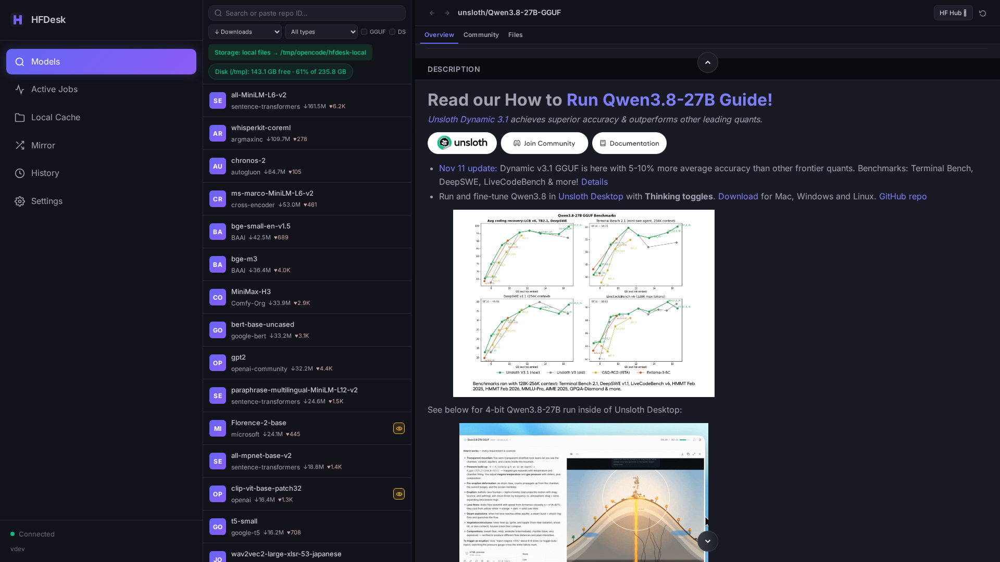
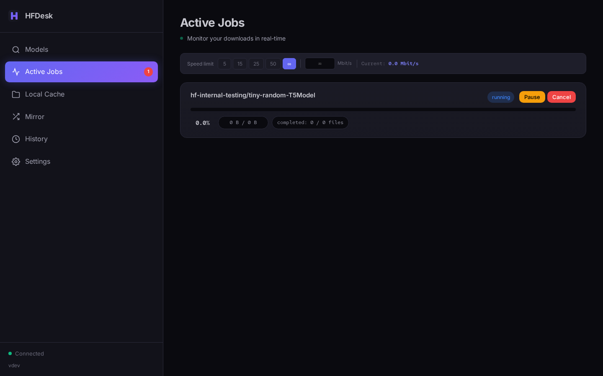
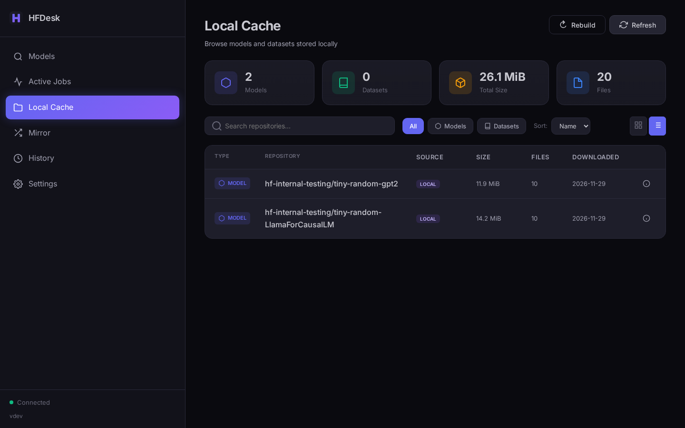
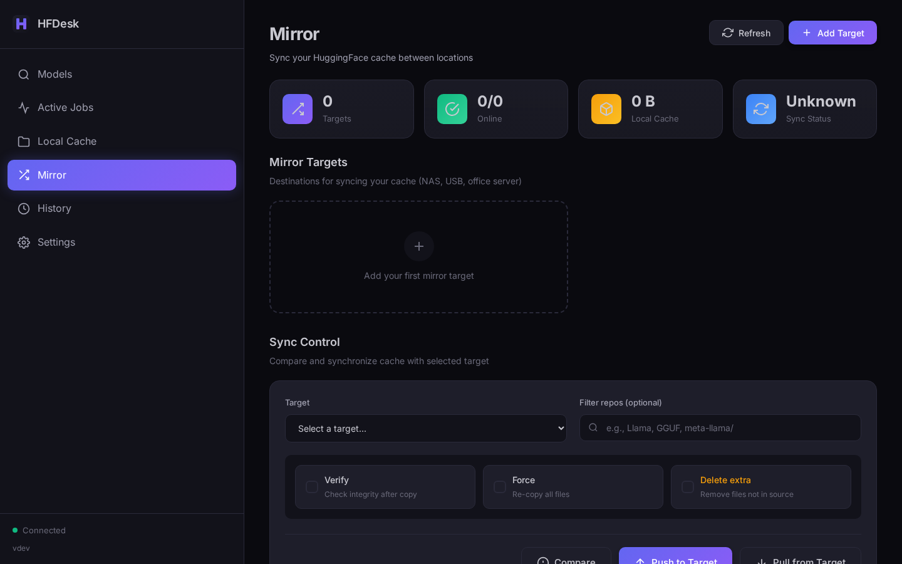
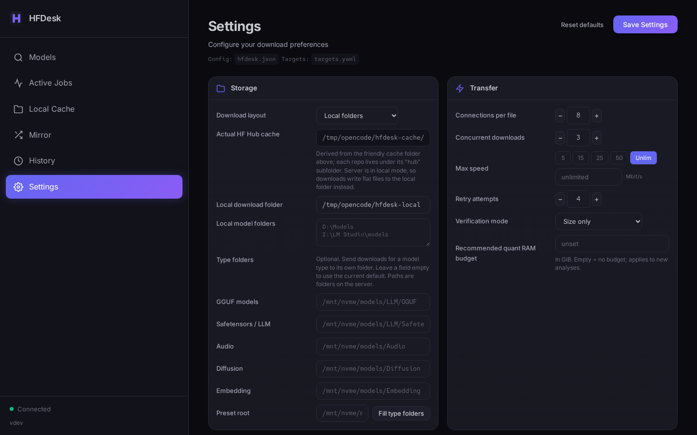

# HFDesk

[](https://github.com/bashrusakh/hfdesk/releases)
[](https://pkg.go.dev/github.com/bashrusakh/hfdesk)
[](LICENSE)

**A local web dashboard for finding, analyzing, downloading, and managing
Hugging Face models and datasets.**

Start HFDesk and it opens in your browser: search the Hub, inspect a
repository before pulling it, download with resume, browse your local cache,
and mirror models to another drive. One static binary, UI included.



## Highlights

- Search models and datasets directly on the Hugging Face Hub.
- See what a repository contains before downloading: quantizations, file
  groups, RAM estimates, recommended picks.
- One option per quantization — sharded GGUF files are grouped; EXL2/EXL3
  bitrate branches download whole.
- Parallel resumable downloads with progress, retries, and job tracking.
- Standard Hugging Face cache layout or LM Studio-style folders, optionally
  sorted by model type.
- Cache browser for HF cache, friendly folders, and added model directories;
  mirror to a NAS, USB drive, or another machine.
- Download history, disk-free indicator, proxy support, optional basic auth.

## Screenshots

| Active Jobs | Local Cache |
|---|---|
|  |  |

| Mirror | Settings |
|---|---|
|  |  |

## Install

Prebuilt binaries for Linux, macOS, and Windows are on the
[Releases](https://github.com/bashrusakh/hfdesk/releases) page, alongside a
Linux RPM; every release ships a `checksums.txt` with SHA-256 sums. File names
carry the release tag (for example `hfdesk_linux_amd64_v1.3.0`,
`hfdesk_darwin_arm64_v1.3.0`).

Windows ships two files — see [Windows desktop app](#windows-desktop-app):

| Download | Use it for |
|---|---|
| `hfdesk_windows_amd64_v1.3.0.exe` | a terminal, a script, a service |
| `hfdesk-desktop_windows_amd64_v1.3.0.exe` | everyday desktop use |

Or install from source:

```bash
go install github.com/bashrusakh/hfdesk/cmd/hfdesk@latest
```

There is also an official [Docker image](#docker).

## Quick Start

```bash
hfdesk
```

HFDesk opens [http://localhost:8080](http://localhost:8080) automatically.
Useful options:

```bash
hfdesk --no-open
hfdesk --port 9090
hfdesk --token hf_xxx
hfdesk --cache-dir /mnt/ssd/huggingface
hfdesk --local-dir /mnt/models
```

## Windows desktop app

The two Windows files are the same program with the same configuration and
options, built for different jobs: the console binary for terminals, scripts,
and services; the desktop binary for everyday use. It is a GUI program and
never opens a console window. The two are paired — installing the Windows
service from the desktop app needs the console program of the same release in
the same folder.

The desktop app wraps the same server in a small shell:

- an icon in the notification area (the system tray); a left click opens the
  **Logs** window,
- **Logs** shows server status, active jobs, and live log records — or, when
  the address it loads does not answer, an honest state with actions to take,
- the tray menu offers **Open HFDesk**, **Logs**, a **Service** submenu with
  the Windows service state and the service actions of that state
  (**Install service…**, **Start service**, **Stop service**,
  **Update service**, **Delete service**), and **Quit HFDesk**.

**Service.** **Install service…** can install the Windows service (it asks
first, then requests administrator rights). The service is a second HFDesk
with separate data under `%ProgramData%\HFDesk` — the desktop app's settings,
jobs, and models are not shared. Full behavior is in
[docs/SERVICE.md](docs/SERVICE.md#the-windows-desktop-host).

**Tray companion.** With the service installed, the desktop app can sit in the
tray beside it without running its own server, and after an installation it
restarts exactly like that.

**Portability.** HFDesk stays portable: the only file it can download is the
missing paired console program, from its own official release, on request and
after checksum verification.

**Requirements.** The Logs window needs the
[Microsoft Edge WebView2 Evergreen runtime](https://developer.microsoft.com/microsoft-edge/webview2/);
when it is missing, HFDesk says so, and the server, tray icon, and web UI all
keep working. A second launch detects the running instance and opens its web
UI instead of starting another server.

The desktop app writes a rotating log to
`%LocalAppData%\HFDesk\logs\hfdesk.log`, shown live in the Logs window. Both
builds accept the logging options:

```bash
hfdesk --log-level debug
hfdesk --log-file /var/log/hfdesk.log
```

`--log-level` sets the minimum level (`debug`, `info`, `warn`, `error`;
default `info`); `--log-file` writes a rotating log file.

## Configuration

HFDesk reads `hfdesk.json`, `hfdesk.yaml`, or `hfdesk.yml` from the launch
directory first, then from `~/.config`. Settings saved from the UI are written
back to the launch directory.

The Hugging Face token is resolved as `--token`, then the `HF_TOKEN`
environment variable, then the config file:

```bash
HF_TOKEN=hf_xxx hfdesk
```

Saved configuration contains stored credentials in plaintext; files are
owner-only (`0600`) on Unix.

```json
{
  "token": "hf_xxx",
  "cache-dir": "/mnt/ssd/huggingface",
  "connections": 8,
  "max-active": 3,
  "multipart-threshold": "32MiB",
  "verify": "size",
  "retries": 4,
  "endpoint": "https://huggingface.co"
}
```

`--cache-dir` picks the root for the friendly `models/` and `datasets/`
folders (falling back to `HF_HOME`, then `~/.cache/huggingface`); a nonempty
`HF_HUB_CACHE` always selects the exact Hub directory:

```bash
HF_HUB_CACHE=/mnt/shared-hf-store hfdesk --cache-dir /mnt/friendly-views
```

The storage fields the API reports are described in
[docs/API.md](docs/API.md#settings). Proxy example:

```json
{
  "proxy": {
    "url": "socks5://proxy.internal:1080",
    "username": "user",
    "password": "pass",
    "no_proxy": "localhost,127.0.0.1"
  }
}
```

## Service mode

HFDesk can run as a supervised background service — systemd on Linux, launchd
on macOS, the Windows Service Control Manager — as a headless process owned by
the supervisor:

```bash
hfdesk service install
hfdesk service status
```

Service mode binds loopback by default (`127.0.0.1:8080`); exposing the
dashboard to the network needs an explicit `--listen 0.0.0.0:8080`. See
[docs/SERVICE.md](docs/SERVICE.md) for the full reference: scopes, state
paths, credentials, logs, upgrades, and per-platform notes.

## API

The web UI is backed by a local JSON API. See [docs/API.md](docs/API.md) for
endpoints, request shapes, and response formats.

## Build

Requires Go 1.26 (see `go.mod`).

```bash
git clone https://github.com/bashrusakh/hfdesk
cd hfdesk
go build -o hfdesk ./cmd/hfdesk
./hfdesk
```

Run tests:

```bash
go test ./...
go test ./... -race
```

The Windows desktop build uses the GUI subsystem and an embedded resource that
carries the icon and application manifest:

```bash
go install github.com/akavel/rsrc@v0.10.2
go run ./cmd/hfdesk/genico.go
rsrc -ico cmd/hfdesk/hfdesk.ico -manifest cmd/hfdesk-desktop/hfdesk.manifest -o cmd/hfdesk-desktop/resource_windows_amd64.syso
go build -ldflags "-H=windowsgui" -o hfdesk-desktop.exe ./cmd/hfdesk-desktop
```

Cross-compile:

```bash
GOOS=windows go build -ldflags "-H=windowsgui" -o hfdesk-desktop.exe ./cmd/hfdesk-desktop
```

A binary built without the flag or the resource still works but opens a
console window, and the app explains how to rebuild it correctly.

## Docker

The image keeps all writable state (settings, jobs, history, HF cache, local
models) under one `/data` root — mount a single volume to persist it:

```bash
docker run --rm -p 8080:8080 \
  -v hfdesk-data:/data \
  ghcr.io/bashrusakh/hfdesk:latest
```

Run as your own user (NAS/homelab):

```bash
docker run --rm -p 8080:8080 \
  -e PUID=1026 -e PGID=100 -e UMASK=002 \
  -v /mnt/user/appdata/hfdesk:/data \
  ghcr.io/bashrusakh/hfdesk:latest
```

- `PUID` / `PGID` — UID/GID the app runs as (default `1000`).
- `UMASK` — file creation mask (default `022`).

Hardened non-root startup — pass `--user` (Kubernetes: `runAsUser` /
`runAsGroup`, `allowPrivilegeEscalation: false`) and the entrypoint execs the
app directly:

```bash
docker run --rm --user 568:568 --read-only --cap-drop=ALL \
  --security-opt=no-new-privileges -p 8080:8080 \
  -v hfdesk-data:/data \
  ghcr.io/bashrusakh/hfdesk:latest
```

`/data` must be writable by that UID/GID; non-root startup never repairs
permissions. Build your own image with `docker build -t hfdesk .`.

**Upgrading from an older image.** The cache root moved to
`/data/.cache/huggingface`. Point your volume at `/data` (recommended), or
seed it from an old host cache:

```bash
mkdir -p /path/to/your/data/.cache
mv ~/.cache/huggingface /path/to/your/data/.cache/huggingface
```

If an existing volume was written by a different UID, fix ownership once:

```bash
sudo chown -R 1026:100 /mnt/user/appdata/hfdesk
```

## Documentation

- [docs/API.md](docs/API.md) — HTTP API reference
- [docs/SERVICE.md](docs/SERVICE.md) — service mode reference
- [pkg/hfdownloader/doc.go](pkg/hfdownloader/doc.go) — downloader and cache
  correctness contract
- [CHANGELOG.md](CHANGELOG.md) — release history, with long-form notes in
  [docs/releases](docs/releases/README.md)
- [CONTRIBUTING.md](CONTRIBUTING.md) — commit and pull request conventions

## Credits

HFDesk is a fork of
[bodaay/HuggingFaceModelDownloader](https://github.com/bodaay/HuggingFaceModelDownloader).
Original copyright and license notices are retained. Licensed under the
[Apache License 2.0](LICENSE).
